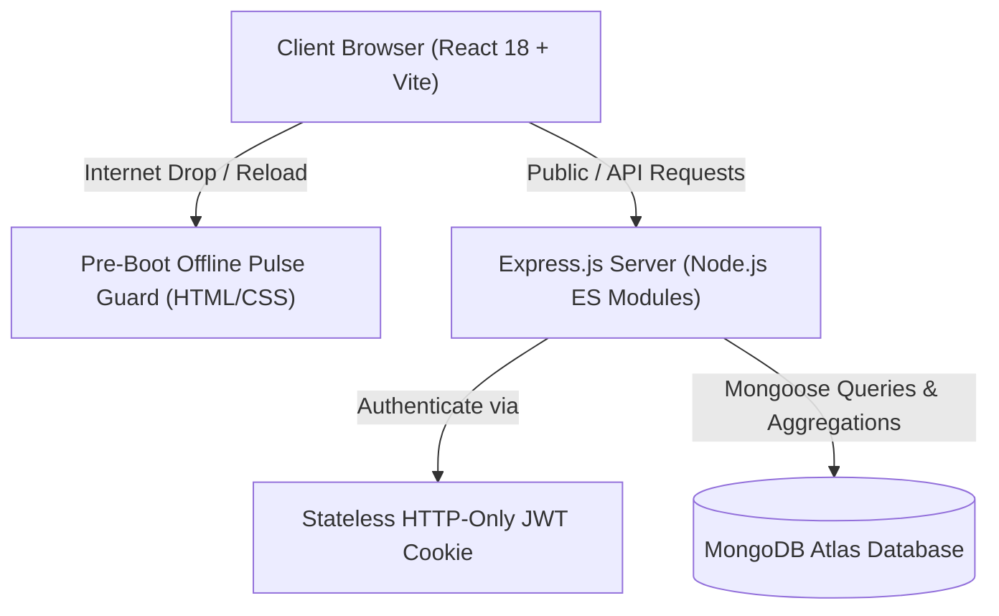

# ContentFlow – Complete Architectural & Technical Project Flow Guide

> **Project Name**: ContentFlow (Editorial CMS & Engineering Publishing Platform)  
> **Tech Stack**: MongoDB Atlas, Express.js (Node.js ES Modules), React 18, Vite, Tailwind CSS, Lucide Icons, Three.js (WebGL), Google OAuth 2.0  
> **Architecture Level**: Enterprise Full-Stack Production Standard

---

## 📑 Table of Contents
1. [Executive Overview & Core Architecture](#1-executive-overview--core-architecture)
2. [Folder & Directory Structure](#2-folder--directory-structure)
3. [End-to-End System Flow (Request Life Cycle)](#3-end-to-end-system-flow-request-life-cycle)
4. [Backend Deep Dive (Node.js, Express & MongoDB)](#4-backend-deep-dive-nodejs-express--mongodb)
   - Database Models & Schema Design
   - Authentication & Role-Based Access Control
   - Controller & Service Architecture
   - Seeding & Data Integrity
5. [Frontend Deep Dive (React 18 & Vite)](#5-frontend-deep-dive-react-18--vite)
   - Layout Division (Public vs Admin Portal)
   - State Management & Global Auth Context
   - Route Protection & Code Splitting
   - Three.js Interactive 3D Sphere Integration
   - 3D Stacked Deck Card Micro-Interactions
6. [Special Features & Engineering Enhancements (1st to Last)](#6-special-features--engineering-enhancements-1st-to-last)
   - Pre-Boot Offline Detection (Concept 03 Network Pulse)
   - Cartoon-Animated 3D 404 Experience
   - Global Scrollbar Removal & Fixed Constant Header
   - Visual Spacing & Typography Hierarchy
   - Google OAuth Resilience & Bug Hardening
7. [API Endpoints Reference](#7-api-endpoints-reference)
8. [Production Deployment & Running Locally](#8-production-deployment--running-locally)

---

## 1. Executive Overview & Core Architecture

ContentFlow is designed as a **decoupled, secure, enterprise-grade publishing system**. It provides:
1. **Public Reader Surface**: High-performance, SEO-friendly reading experience for tech professionals, architects, and software builders.
2. **Admin Command Portal**: Strict role-gated administrative suite for content drafting, publication, categorization, and telemetry tracking.
3. **Resilient Network Handling**: Instant offline/slow network detection rendering before Javascript bundles bootstrap.



---

## 2. Folder & Directory Structure

```text
content_flow/
├── client/                           # Frontend React Application
│   ├── public/                       # Static assets, favicon, media
│   ├── src/
│   │   ├── components/               # Modular UI Components
│   │   │   ├── cards/                # ContentCard.jsx (3D stacked deck effect)
│   │   │   ├── common/               # Button, Modal, Badge, BrandLogo, HeroTechAnimation
│   │   │   └── forms/                # Form controls with Zod + React Hook Form
│   │   ├── context/                  # AuthContext.jsx (Persistent JWT & user state)
│   │   ├── layouts/                  # PublicLayout.jsx & AdminLayout.jsx
│   │   ├── pages/
│   │   │   ├── public/               # HomePage, ContentListPage, ContentDetailPage,
│   │   │   │                         # AboutPage, ContactPage, NotFoundPage (Animated 404)
│   │   │   └── admin/                # AdminLoginPage, DashboardOverview,
│   │   │                             # ContentManager, ContentCreate, ContentEdit, CategoryManager
│   │   ├── routes/                   # AppRoutes.jsx & ProtectedRoute.jsx
│   │   ├── services/                 # Axios API clients (authService, contentService, etc.)
│   │   ├── utils/                    # Formatters, reading-time calculation, error handlers
│   │   ├── index.css                 # Master Tailwind styles & animations
│   │   └── main.jsx                  # React Entry with Google OAuth Provider
│   ├── index.html                    # Root HTML with Concept 03 Pre-Boot script
│   ├── tailwind.config.js            # Custom color palettes & keyframe definitions
│   └── vite.config.js                # Build configuration with dynamic chunking
├── server/                           # Backend Node.js Application
│   ├── src/
│   │   ├── config/                   # db.js (Mongoose connection pool)
│   │   ├── controllers/              # authController, contentController, categoryController
│   │   ├── middleware/               # auth.js (JWT validation), errorHandler.js, rateLimiter.js
│   │   ├── models/                   # Content.js, Category.js, User.js
│   │   ├── routes/                   # authRoutes, contentRoutes, categoryRoutes
│   │   ├── utils/                    # seedData.js, slugify.js, tokenGenerator.js
│   │   └── server.js                 # Express server bootstrap & middleware pipeline
│   └── package.json
└── project flow.md                   # This master documentation file
```

---

## 3. End-to-End System Flow (Request Life Cycle)

1. **Page Request**: User requests `http://localhost:5173/` or any domain URL.
2. **Pre-Boot Network Check**: `index.html` inline script checks `navigator.onLine`. If offline, Concept 03 Network Pulse displays instantly without waiting for Vite bundles.
3. **React Mount**: `main.jsx` initializes `GoogleOAuthProvider`, sonner toaster notifications, and React Router (`AppRoutes.jsx`).
4. **Data Retrieval**: `HomePage.jsx` triggers parallel API requests:
   - `contentService.getFeaturedContent()`
   - `contentService.getPublicArticles({ limit: 6 })`
   - `categoryService.getPublicCategories()`
5. **Backend Processing**:
   - Express receives `GET /api/content/featured`.
   - Mongoose runs an indexed query on MongoDB Atlas with `.populate('category')`.
   - JSON payload returns with standard structure: `{ success: true, data: { ... } }`.
6. **Rendering**:
   - Hero Section renders the interactive 3D Three.js sphere.
   - Articles render inside the physical 3D Stacked Deck card wrappers.

---

## 4. Backend Deep Dive (Node.js, Express & MongoDB)

### Database Schemas
- **User Model (`User.js`)**: Stores administrative users with bcrypt password hashing (`saltRounds: 12`), roles (`admin`), and optional Google OAuth `googleId`.
- **Category Model (`Category.js`)**: Taxonomies with automatic URL slugification (`slugify.js`), color metadata, and article counter caching.
- **Content Model (`Content.js`)**: Articles with markdown support, reading time calculation, status (`draft` vs `published`), tags array, and indexed cover image metadata.

### Security Pipeline
- **HTTP-Only Cookies**: JWT tokens are transmitted via `res.cookie('cf_token', token, { httpOnly: true, secure: true, sameSite: 'lax' })` to mitigate XSS-based token theft.
- **Rate Limiting**: Protects login and content APIs against brute-force attacks via `express-rate-limit`.
- **CORS Protection**: Restricted to authorized origins with `credentials: true`.

---

## 5. Frontend Deep Dive (React 18 & Vite)

### Layout Isolation
- **`PublicLayout.jsx`**:
  - **Constant Fixed Header**: Locked `fixed top-0 left-0 right-0 z-50` with `backdrop-blur-xl`.
  - Brand Logo with crisp vector geometry.
  - Dropdown menu of dynamically fetched categories.
  - Responsive mobile drawer.
- **`AdminLayout.jsx`**:
  - Responsive sidebar with live MongoDB health indicator.
  - Dashboard analytics shortcuts, article publishing, and category management.

### Three.js Interactive Hero Sphere
- Located in `client/src/components/common/HeroTechAnimation.jsx`.
- Uses WebGL renderer with custom wireframe geodesic geometry, particle rings, and mouse parallax interaction.
- Positioned strictly behind the text layer (`pointer-events-none`) so links and buttons remain clickable.

### 3D Stacked Deck Card Micro-Interactions
- Located in `client/src/components/cards/ContentCard.jsx`.
- Styled using physical paper layers (`.deck-layer-1`, `.deck-layer-2`) in `index.css`.
- Hovering or touching on mobile triggers a card lift (`translateY(-12px) scale(1.02)`) with fan-out rotation angles.

---

## 6. Special Features & Engineering Enhancements (1st to Last)

Here is a chronological breakdown of what was engineered:

### Feature 1: Concept 03 – Minimal Network Pulse Animation
- **Goal**: Show a futuristic glowing pulse screen ONLY when network drops or becomes unstable.
- **Implementation**:
  - Pure `#070908` background with glowing neon-yellow central dot (`#F4C52E`) and expanding neon-green wave rings (`#A6EE38`).
  - Implemented both as a React component (`NetworkStatusOverlay.jsx`) and an inline pre-boot fallback in `index.html`.
  - Fixed initial white/black screen flicker during browser refresh.

### Feature 2: Animated Cartoon 3D 404 Page
- **Goal**: Full-page 404 matching reference design with 3 independently dancing cartoon mascots.
- **Implementation**:
  - Center '0' in `404` replaced by bouncing DJ Headphone Smiley with neon glow.
  - Left character: Animated hoodie robot dancing and pointing rhythmically (`@keyframes danceLeft`).
  - Right character: Cool cat in golden sunglasses swaying and wagging its tail (`@keyframes danceRight`, `@keyframes tailWag`).
  - Floating green/yellow musical notes (`@keyframes noteFloat`) and revolving planetary orbital rings (`@keyframes orbitSpin`).
  - Mounted on catch-all route `<Route path="*" element={<NotFoundPage />} />`.

### Feature 3: Hero Headline Spacing & 3D Bubble
- **Goal**: Clean 3-tier distribution with space between words on desktop.
- **Implementation**:
  - Line 1: `Curated Insights` (single line, expanded tracking).
  - Line 2: `Modern Software` (golden yellow, balanced vertical gap).
  - Line 3: `BUILDERS` enclosed in an ultra-attractive liquid glass bubble with ambient glow reflection and pulsing accent star.

### Feature 4: Global Scrollbar Removal & Fixed Navbar
- **Goal**: Remove unwanted side scrollbars and prevent navbar jumping during scroll.
- **Implementation**:
  - Added cross-browser scrollbar hiding in `index.css` (`display: none;`, `scrollbar-width: none;`).
  - Changed `header` from `sticky` to `fixed top-0` with `pt-20` body offset.

### Feature 5: Page Transitions & Card Micro-Animations
- **Goal**: Smooth interactive feel across About, Contact, and Admin Dashboard.
- **Implementation**:
  - About Page: Floating pill badges, rotating tech layers icon, and glowing architectural pillar cards.
  - Contact Page: High-contrast gradient typography, bouncing mail icon, and pulse indicator.
  - Dashboard Overview: KPI cards with radial backlighting scale (`group-hover:scale-150`).

### Feature 6: Linter & OAuth Stability Fixes
- **Goal**: Resolve `Unknown at rule @tailwind` warnings and Google Sign-in crashes.
- **Implementation**:
  - Configured `.vscode/settings.json` to recognize Tailwind CSS at-rules.
  - Fixed Google button width constraint from `"100%"` to integer pixel width (`"320"` / `"280"`).
  - Unconditionally mounted `GoogleOAuthProvider` in `main.jsx` to prevent missing-context crashes on the Admin Portal modal.
  - Restored clean, readable fonts (`Plus Jakarta Sans`) on Brand Logo and card article titles.

---

## 7. API Endpoints Reference

### Public Endpoints
| Method | Endpoint | Description |
|---|---|---|
| `GET` | `/api/content` | List published articles with pagination, tags, search |
| `GET` | `/api/content/featured` | Fetch featured hero article |
| `GET` | `/api/content/:slug` | Retrieve single published article details |
| `GET` | `/api/categories` | List active categories with article counts |
| `GET` | `/api/auth/google/client-id` | Retrieve Google OAuth Client ID for login |

### Protected Admin Endpoints (Requires JWT Cookie)
| Method | Endpoint | Description |
|---|---|---|
| `POST` | `/api/auth/login` | Authenticate admin with email and password |
| `POST` | `/api/auth/google` | Authenticate admin via Google OAuth token |
| `GET` | `/api/auth/me` | Fetch authenticated session profile |
| `POST` | `/api/auth/logout` | Clear HTTP-only authentication cookie |
| `GET` | `/api/content/admin/all` | List all articles including drafts and metrics |
| `POST` | `/api/content` | Create new article |
| `PUT` | `/api/content/:id` | Update existing article |
| `PATCH`| `/api/content/:id/status`| Toggle article between draft and published |
| `DELETE`| `/api/content/:id` | Delete article from MongoDB |
| `POST` | `/api/categories` | Create new category |

---

## 8. Production Deployment & Running Locally

### Prerequisites
- Node.js (v18.0.0 or higher)
- MongoDB Database URI (Local or MongoDB Atlas)

### Setup & Run Commands

1. **Install Dependencies**:
   ```bash
   npm run install:all
   ```

2. **Configure Environment Variables**:
   In `server/.env`:
   ```env
   PORT=5000
   NODE_ENV=development
   MONGODB_URI=mongodb+srv://<username>:<password>@cluster.mongodb.net/contentflow
   JWT_SECRET=super_secret_production_key_contentflow
   CLIENT_URL=http://localhost:5173
   GOOGLE_CLIENT_ID=your-google-oauth-client-id.apps.googleusercontent.com
   ```

3. **Seed Database with Sample Articles**:
   ```bash
   npm --prefix server run seed
   ```

4. **Start Development Servers (Concurrent Backend + Frontend)**:
   ```bash
   npm run dev
   ```
   - Client runs on: `http://localhost:5173`
   - Server runs on: `http://localhost:5000`

5. **Build for Production**:
   ```bash
   npm --prefix client run build
   ```


---

## 9. FAQ & Technical Explanations (Hinglish)

### Q1: Is project mein images kahan store ho rahi hain aur ise kaise implement kiya gaya hai?

#### Answer:

Is project mein images **2-tier hybrid architecture** ke through handle aur store hoti hain:

#### 1. Real Production Storage: Cloudinary (Cloud Object CDN)
- Jab Admin dashboard se koi article banata hai ya update karta hai, image direct **Cloudinary** par store hoti hai.
- Cloudinary par images `contentflow/articles` folder ke andar automatically:
  - Max resolution (`1400x900`) par resize hoti hain (`crop: 'limit'`).
  - Next-gen format (`WebP/AVIF`) aur auto-compression (`quality: 'auto'`, `fetch_format: 'auto'`) apply hota hai.
- MongoDB ke andar heavy image binary file store nahi hoti, balki sirf uska **Cloud CDN URL** (`image.url`) aur **Public Identifier** (`image.publicId`) save hota hai. Isse database fast aur lightweight rehta hai.

#### 2. Local / Development Fallback Storage: Zero-Crash In-Memory Fallback
- Agar Cloudinary ki API keys `.env` mein configured nahi hain ya internet issue ki wajah se Cloudinary down ho jaye:
  - System crash nahi hota.
  - Backend ka `cloudinaryService.js` buffer ko automatically **Base64 Data URI** (`data:image/jpeg;base64,...`) mein convert kar deta hai aur MongoDB mein save kar leta hai.
  - Iska fayda: Development ke dauran bina Cloudinary account ke bhi image upload and view 100% smoothly chalta hai.

#### 3. Step-by-Step Implementation Flow (Kaise Kaam Karta Hai?):
1. **Frontend (Upload)**:
   - Admin `ContentCreate.jsx` ya `ContentEdit.jsx` mein image select karta hai.
   - Frontend `FormData` object banata hai aur `multipart/form-data` format mein backend ko bhejta hai.
2. **Backend Middleware (`uploadMiddleware.js`)**:
   - `Multer` library use ki gayi hai with `multer.memoryStorage()`.
   - File hard disk par temporary save hone ke bajaye direct **RAM buffer** mein aati hai (zero disk pollution).
   - Validation checks: Sirf JPG, PNG, WEBP, GIF allow hain aur max size limit **5MB** hai.
3. **Cloudinary Stream Service (`cloudinaryService.js`)**:
   - RAM buffer se stream create karke direct Cloudinary API par upload hota hai (`cloudinary.uploader.upload_stream`).
4. **MongoDB Persistence (`Content.js`)**:
   - Upload successful hone par MongoDB document mein ye structure save hota hai:
     ```javascript
     image: {
       url: "https://res.cloudinary.com/.../article-banner.webp",
       publicId: "contentflow/articles/xyz123"
     }
     ```
5. **Old Image Deletion on Update/Delete**:
   - Agar article edit karke nayi image dali jaye ya article delete kiya jaye, to `cloudinary.uploader.destroy(publicId)` call hokar purani image Cloudinary se delete ho jati hai taaki storage waste na ho.
